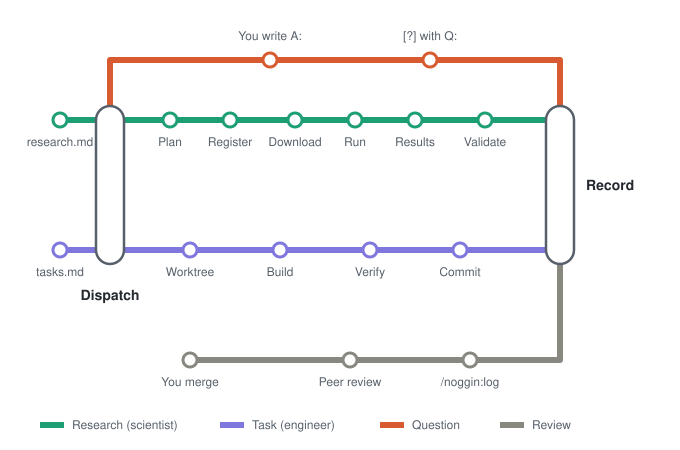

# noggin

<p align="center"></p>

A Claude Code plugin for deterministic engineering and science. Turn it on in any project.

```
CLAUDE.md                 house rules, injected at session start with the project's graphify report (hooks/)
skills/init               /noggin:init: creates tasks.md, research.md, their logs, research/data/, research/datasets.md, noggin.conf
skills/dispatch           tasks.md + research.md -> engineers/scientists -> tasks.log + research.log
skills/verify             nf-test snapshots, built from tests/data/
skills/worktree           one worktree + branch per writing agent; the user merges
skills/check              /noggin:check: download, run-time and spend limits in noggin.conf
skills/log                /noggin:log: every log entry with its hash; /noggin:log <hash> for details
skills/peer-review        /noggin:peer-review <hash>[-<k>]: three independent reviewers, verdict in the log
agents/                   engineer, scientist
watch.sh                  re-dispatches when tasks.md or research.md gets an open item
scripts/clean-tmp.sh      deletes an item's tmp/ folders once it is [x]; the user manages research/data/.
scripts/init.sh           run by /noggin:init; creates only what is missing
scripts/fetch.sh          omics downloads: prefixes in research/datasets.md only, into research/data/ only
templates/datasets.md     curated sources (Arc, CELLxGENE, ENCODE, NCBI, PRIDE, ...); /noggin:init copies it to research/
```

## Install

```
/plugin marketplace add ~/Documents/Github/noggin
/plugin install noggin@noggin
```

Enable it per project in `.claude/settings.json`:
```json
{ "enabledPlugins": { "noggin@noggin": true } }
```

Try it without installing: `claude --plugin-dir ~/Documents/Github/noggin`.

Optional: [ponytail](https://github.com/DietrichGebert/ponytail). With it installed, engineers work at ponytail's ultra level and push back on tasks the need doesn't justify. Add it next to noggin in `.claude/settings.json` (or `~/.claude/settings.json` for every project):
```json
{
  "enabledPlugins": { "noggin@noggin": true, "ponytail@ponytail": true },
  "extraKnownMarketplaces": {
    "ponytail": { "source": { "source": "github", "repo": "DietrichGebert/ponytail" } }
  }
}
```

## Use

In the project, run `/noggin:init` once, then write `- [ ] ...` lines in `tasks.md` (coding or analysis) or `research.md` (topics to research). Then either run `/noggin:dispatch`, or start the watcher:

```bash
~/Documents/Github/noggin/watch.sh
```

Research topics can set how many hypotheses to test, one per round: `- [ ] topic (hypotheses: 3)`, default 1. One dispatch runs every round of a topic, logging each before the next, and the count advances (`1/3`, `2/3`, ...).

Each round is pre-registered: a scientist writes the plan (discovery data, held-out validation data, a negative control), dispatch records its sha256, and a fresh scientist runs it on the discovery data. A `supported` result goes to a third scientist, who runs the same plan on the held-out data: `replicated` or `not replicated`. With no independent dataset it stays `supported (unreplicated)`. To choose the held-out data yourself, add `(validate: <accession>)` to the item. A significant negative control blocks the round: the pipeline is broken or gaming the test.

Prediction modeling goes in `research.md` too: tag the item with its primary metric, e.g. `- [ ] Predict drug response from baseline expression (metric: AUROC)`, or leave it empty, `(metric:)`, for the planning scientist to choose one (RMSE, MAE, AUROC, AUPRC, F1, MCC, macro-F1, balanced accuracy, C-index). The model must beat a pre-registered baseline (p < 0.05), is trained only on discovery data, and is scored once on the held-out data. Add `(iterations: N)` to improve the model over up to N passes: every iteration uses the same discovery samples, folds, permuted labels and held-out data, and only the best iteration is scored on the held-out data, once, at the end.

Items become `[x]` when done or `[?]` when an agent needs you, with its question underneath. Write your answer on a new line below it, then set the item back to `[ ]`:
```
- [ ] add fastp step to qc pipeline
  - Q: Trim adapters only, or quality-trim too?
  - A: adapters only
```

Knowledge: [graphify](https://github.com/Graphify-Labs/graphify) (`uv tool install "graphifyy[pdf]"`, then `/graphify .` in the project). Each session starts with `graphify-out/GRAPH_REPORT.md` in context; agents query `graph.json` for details.
